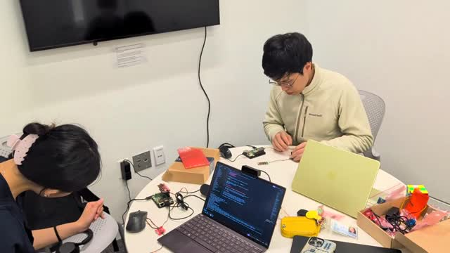
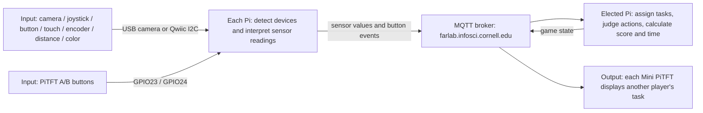
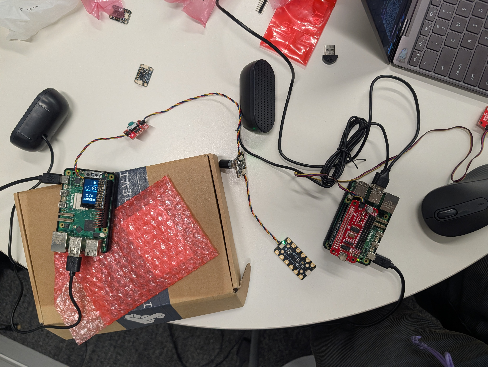

# Spacecrew

**Team:** Elliott Kalt (esk226), Jovian Wang (jlw457), Alexa Yang (ay482)

A Spaceteam-style game for 2+ Raspberry Pis over MQTT. Each Pi shows an order
for someone else's sensors, so you shout what you see while listening for what
your own station can do.

[](../imgs/video-h264.mp4)

## 1. Project Description

Every player's screen shows one instruction, like "TURN ENCODER 3 CLICKS
CLOCKWISE" or "TOUCH PAD 7", meant for another player's hardware. Under it is a
grid of your own sensors showing their live state, so you can see your inputs
register. Each Pi can have any mix of sensors we support (camera, joystick,
button, touch pads, rotary encoder, distance, color), and tasks are generated
from whatever is plugged in.

Rounds last 60 seconds. Finishing a task fast earns more points, a timed-out
task costs 15, a wrong button or pad costs 5, and five errors in a round loses
the ship. Twice a round a hazard (asteroids, solar flare, ion storm or black
hole) makes everyone mash A/B. Each round introduces a new challenge with a
title card: Glitch (typos), Turbulence (shaking text), Nebula (fading text),
Wormhole (mirrored text), Overload (two inputs at once) and Warp Speed (half
the time). Survive round 10 to win.

Feedback is a green or red border on both the doer's and the caller's screen,
plus sound effects (CC0 clips from Freesound, credited in
[sounds/CREDITS.md](sounds/CREDITS.md)).

## 2. Architecture Diagram



Every Pi runs the same program; the first station name alphabetically becomes
the coordinator, and if it drops out another takes over.

MQTT topics under `IDD/jovian21/spaceteam/v1`:

- `presence/<station>`: detected controls, ready state, and device identity.
- `input/<station>`: sensor readings and PiTFT button events.
- `state`: assigned tasks, timer, score, and hazard progress.

## 3. Build Documentation

| Pi | Sensors |
| --- | --- |
| A | USB webcam; Mini PiTFT |
| B | Qwiic joystick, red button, MPR121 touch sensor (pads 0-11); Mini PiTFT |
| C | Qwiic rotary encoder, distance sensor, color sensor; Mini PiTFT |

Sensors are discovered at startup, so roles follow the connected hardware.



- [engine.py](engine.py): game rules (tasks, scoring, rounds, hazards). Nothing hardware-specific.
- [hardware.py](hardware.py): turns each sensor into a named reading, e.g. the touched pad number:

  ```python
  touched = [str(pad) for pad, value in enumerate(device.touched_pins) if value]
  return touched[0] if touched else 'released'
  ```

- [visuals.py](visuals.py): draws the screen (instruction over the starfield, sensor cells, hazards, challenges).
- [game.py](game.py): MQTT, coordinator election, sounds and the display loop.

Implementation assistance: OpenAI Codex, Claude Code.

<details>
<summary>How to run</summary>

On every Pi with I2C/SPI enabled and sensors connected:

```bash
cd "Lab 6"
python3 -m venv .venv
source .venv/bin/activate
pip install -r spaceteam/requirements.txt
# Camera Pi only:
pip install -r spaceteam/requirements-camera.txt
sudo systemctl stop piscreen.service
python spaceteam/game.py
```

Everyone must run the same version. Press PiTFT A to ready up. To test alone,
`python spaceteam/game.py --headless --simulate button` on two terminals and
type `ready`.

</details>

## 4. User Testing

**TODO (team): fill in from the play-test with people outside the team.**

- Who played and when:
- Before trying, what they expected the controls and instructions to do:
- After trying, what surprised them and what they would change:

## 5. Reflection

**What worked:** one program on every Pi with an elected coordinator meant we
never had to set up a server, and showing each sensor's live state on screen
made it obvious when an input wasn't registering.

**Distributed challenges:** inputs that arrive after a task has already
changed, players running different versions of the code (which crashes the
game), and the coordinator switching mid-round. Most of our bugs were about
state arriving late or out of order, not about MQTT itself.

**Sensor reliability:** the rotary encoder was wired backwards from what the
code assumed, so "clockwise" tasks could never be completed; the joystick's
center was sampled at startup, so some directions became impossible; and
everyone pinches differently, so pinch now means the thumb touching any
fingertip. Held inputs (joystick, distance, color, camera) must stay stable
for 0.35 seconds and carry no wrong-action penalty.

**TODO (team): what users suggested and what we changed because of it.**
